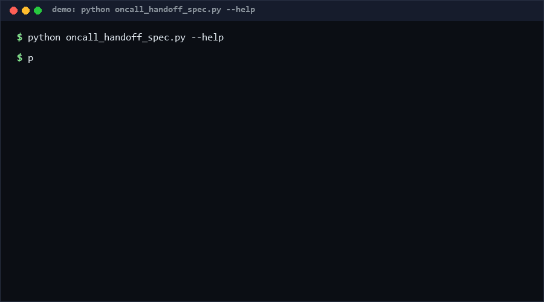

# oncall-handoff-spec

A schema and completeness validator for on-call shift handoff documents.
The spec fixes the four sections that matter — in-progress items (with the
next step), risks (severity + mitigation), muted alerts (reason + expiry),
and optional deployments/open questions — and scores completeness on a
0–1 scale so teams can gate handoffs in CI. Pure standard library. *No
direct equivalent found as of 2026-10-13.*

<p align="center"></p>

## Problem

Handoffs fail between shifts because they are free-form prose: the incoming
engineer misses an in-progress incident's next step, a high risk without
mitigation, or an alert muted with no expiry that stays silent for days.
Those omissions are structural, so they can be checked mechanically — but
nobody wants to write a parser per team.

## How it works

A **handoff** is JSON: `shift` (start < end), `engineer` (pseudonym ok),
and the three required lists. Per-item rules (R1–R9): every in-progress
item needs `next_step` and `owner`; risks need a valid severity
(`low|medium|high`) and high severity requires a written mitigation
(medium without one warns); every muted alert needs a `reason` and an
`until` timestamp (expiring mid-shift warns).

The validator returns errors, warnings and a **weighted completeness
score** over 15 checks (sections ×3, shift ×2, engineer ×1, in-progress ×2,
severity ×1, mitigations ×2, muted ×2, timestamps ×1, optional sections ×1).
`--min-score` turns the score into an exit-code gate.

## Quickstart

```console
$ python oncall_handoff_spec.py validate handoff.json
score=1.00 OK
$ python oncall_handoff_spec.py validate handoff.json --min-score 0.9
score=0.93 ... (exit 1)
```

A typical document validates in <1ms; 5,000 documents took 0.094s
[Measured] — cheap enough to run on every handoff PR.

## Why not X

No tool with the same scope surfaced during research (checked 2026-10-13),
but adjacent solutions exist:

- **PagerDuty / Opsgenie handoff fields** — ticket metadata (who is on
  call), not a document schema for *what changed*; no completeness scoring.
- **Incident-management templates** (postmortem templates in Notion/Confluence)
  — prose checklists with no machine validation; drift the first busy week.
- **JSON Schema** — could enforce shape, but not semantic rules
  (high-risk⇒mitigation, mute expiry mid-shift) or the weighted score.
- **Standup bots** — collect status updates, not shift-bound handoff
  contracts with an auditable artifact.

## Performance

All numbers [Measured] locally (Python 3.13, Windows 10, single core):

| Workload | Result | Command |
|---|---|---|
| 5,000 handoff documents validated | 0.094s (53k docs/s) | `python oncall_handoff_spec.py bench --docs 5000` |
| Single typical document | <1ms | `python oncall_handoff_spec.py validate handoff.json` |

## Minimal Fallback

A three-question handoff template — "what's in flight + next step?", "what
can break + what are we doing?", "what's muted until when?" — enforced by
review. You lose the exit-code gate and the score history, not the
structure.

## Design Trade-offs

- **Score instead of hard fail on warnings.** Medium risks without
  mitigation degrade the score but do not block; high risks without one do
  (they fail a weighted check, dragging `--min-score 1.0` gates red).
- **Pseudonym-friendly.** Only non-empty strings are required for people
  fields — the spec validates the handoff, not the roster.
- **Mute expiry is mandatory.** Unlimited silences are the classic handoff
  leak; `until` makes every mute a decision with a deadline.
- **JSON in, report out.** No server, no integration lock-in; wire it into
  PR checks or a cron job as you like.

## Limits & Second-order Effects

- The score measures *form*, not insight — a complete-yet-wrong handoff
  still scores 1.0.
- Timestamps are treated as UTC when timezone-naive; teams in one timezone
  are fine, distributed teams should write offsets.
- Gating on `--min-score 1.0` can produce ritual compliance (empty risks
  list to go green); pair the gate with review.
- Muted alerts still fire; the spec records intent, PagerDuty enforces it.

## FAQ

**When NOT to use this?** Not for incident *response* coordination (use your
IM tool), not as a postmortem format (different artifact, different
lifecycle), and not where shifts hand over face-to-face with a shared
screen — the doc adds ceremony without value there.

**Why a weighted score?** Binary pass/fail on a living document is too
brittle; weights encode which omissions hurt the incoming shift most.

**Can I add sections?** Unknown top-level keys are ignored (forward
compatible), but unvalidated — extend the validator if you gate on them.

**Is the engineer field PII-safe?** It is whatever string you put there;
pseudonyms and on-call aliases work by design.

## [Core Assumptions]

1. Handoffs are documents produced once per shift and reviewed by a human —
   not a chat stream.
2. `in_progress`, `risks`, `muted_alerts` are the sections whose omission
   causes real handoff incidents; everything else is optional.
3. Timestamps are ISO-8601 (epoch seconds accepted); naive times are UTC.

Confidence: high in validator/score behavior (self_test.py, 61 cases);
medium on the exact weights — they encode one team's priorities and are
meant to be argued with. As of 2026-10-13.

---

Part of the [zhengming-toolbox](https://github.com/chenhz01/zhengming-toolbox) — 105 purpose-built AI-engineering tools across neglected niches.

Related tools: [merge-conflict-predictor](https://github.com/chenhz01/merge-conflict-predictor) · [backup-integrity-verifier](https://github.com/chenhz01/backup-integrity-verifier) · [team-timezone-overlap](https://github.com/chenhz01/team-timezone-overlap)
